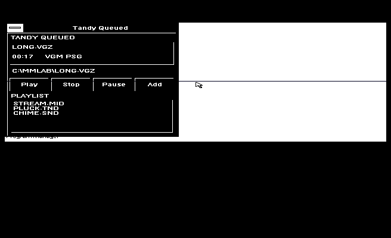

# Native-tested Windows 3.0 format preview

This separate opt-in preview adds VGM/VGZ and bounded MOD PSG arrangements to
MINIPLAY. Open/play/stop/pause/resume/restart, exact raw-write ordering,
unsupported-input refusal and old MIDI/TND/AGI behavior pass the recorded
four-case native fixture: 171 checks, zero failures.

Download [LibWinTandy-Win30-Formats-Native-Preview-20261017.zip](LibWinTandy-Win30-Formats-Native-Preview-20261017.zip). It includes corresponding first-party source, preserved
licenses, original synthetic inputs and generators, host tests, build recipes,
saved commands/maps/logs, actual native receipts and guarded runtime files.
No third-party music, sample data, R-Type converter, OS, fonts, compiler, ROM,
external TSOUND driver or emulator image is included.

SHA-256: `57d98655dcf54c0f166cc57585bb0f084bd8f71bd42ea19fc6a7c7741bf1859a` (256793 bytes, 177 entries).

Read [qualification and cost](../../libtandywin/AUDIO/QUALIFY.MD),
[source profile and ownership](../../libtandywin/AUDIO/FORMATS30.MD),
and [additive RAWCLK API](../../libtandywin/AUDIO/BURST-API.MD).
The [archive manifest](MANIFEST.JSON) lists the files inside FORMATS30 with
sizes and SHA-256 hashes; [AUDIT.JSON](../../libtandywin/AUDIO/AUDIT.JSON)
records exclusions and metadata normalization.
MOD sample timbres are not reproduced. The register/lifecycle checks do not
establish listening fidelity, physical hardware behavior or a CPU speedup.

The existing core preview PRs remain independent. The actual screenshot below
comes from the full-stream native case; it is not a mockup.

Native validation is recorded author-run evidence, not public CI or an independent reviewer rerun.
